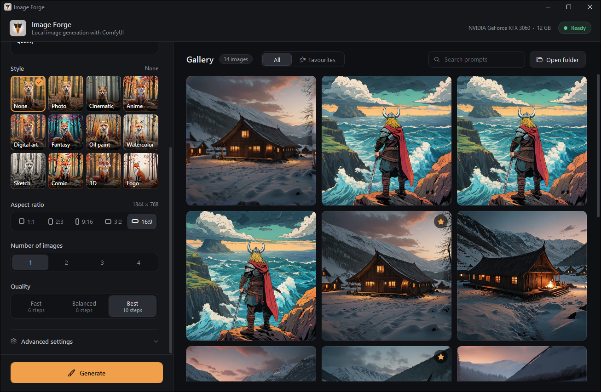

# Image Forge

A Windows app for making pictures and short videos on your own PC with [ComfyUI](https://github.com/comfyanonymous/ComfyUI). Nothing is sent to the cloud.



## What it does

- **Create** pictures from a prompt, with styles, aspect ratios and up to 4 at once
- **Edit photo**: remove objects, expand the picture, fix details, cut out the background, upscale
- **Video**: text-to-video and picture-to-video (Wan 2.1)
- **Reference pictures**: drop a character or a place, and new pictures keep the same face or place (Qwen-Image 2.1)
- **Improve prompt** and **Describe image** with a local text model
- **LoRA add-ons**: several at once, with descriptions and trigger words looked up on Civitai
- **Models page**: download from the built-in list, or paste a Hugging Face / Civitai link
- **Settings per model, and tabs**: each model keeps its own settings; save a setup as a tab, export it and share it
- **Quality guard**: each model's recommended steps, CFG, sampler, size and LoRA strengths, with a warning and **Fix all** when a setting is off
- **Quality boosters**: Fix faces, Hi-res fix, refine with a second model, PAG, RescaleCFG and a colour finish, each offered only on models where it helps
- **Plugins**: optional ComfyUI plugins at pinned, checked versions (Settings > Plugins), and ComfyUI's own editor under **ComfyUI** for experts
- Gallery with favourites, search, and the settings used for each picture

Supported model families: Krea 2, Qwen-Image 2.1, Anima, SDXL, Wan 2.1.

**Models are not included.** Download them from the Models page inside the app.

## Install

1. Download `Image.Forge.exe` from [Releases](../../releases/latest) and run it.
   If Windows says it protected your PC, click **More info** → **Run anyway** (the app isn't code-signed).
2. Press **Set up ComfyUI** and pick a folder with about 12 GB free. The app downloads the official [ComfyUI](https://github.com/Comfy-Org/ComfyUI/releases) portable build (2 GB) and sets it up there.
   Already have the ComfyUI portable build? Pick its folder instead.
3. Open **Models** and download a model to start with (Krea 2 Turbo is a good first one).

The app updates itself: when a new version is out, it downloads in the background and installs when you close the app, or right away with the **Update** button.

Needs Windows 10/11 x64 and an NVIDIA GPU (tested on an RTX 3060 12 GB). If Windows can't unpack ComfyUI by itself (older Windows 10), the app asks you to install [7-Zip](https://www.7-zip.org/).

## Recommended models

These are the models the app is tested with. Items marked **in app** are in the Models page's download list. For the others, copy the link into the Models page's link box and press Download; the app puts each file in the right folder.

### Pictures

| Model | Good for | Files | Size |
|---|---|---|---|
| **Krea 2 Turbo** (in app) | Fast, realistic all-rounder | `krea2_turbo_fp8_scaled`, `qwen3vl_4b_fp8_scaled` (text encoder), `qwen_image_vae` (VAE) | 18.6 GB |
| [FinePorn v5](https://civitai.red/models/2762538) | Uncensored realistic (Krea 2 based; pick the FP8 file) | model only; uses Krea 2's text encoder and VAE | 13.1 GB |
| [Qwen-Image 2.1](https://huggingface.co/Comfy-Org/Qwen-Image-2.1) | Best at following prompts, text in pictures, editing photos by instruction | `diffusion_models/qwen_image_2.1_int8_convrot`, `text_encoders/qwen3vl_8b_int8_convrot`, `vae/qwen_image_2.1_vae_bf16` | 17.3 GB |
| [Noct Q Anime](https://huggingface.co/0xSojalSec/Anime-Uncensored-Qwen-Image-2.1) | Uncensored anime (Qwen-Image 2.1 based) | `NoctQA_V1_int8_convrot`; uses Qwen-Image's text encoder and VAE | 7.3 GB |
| [Anima](https://huggingface.co/circlestone-labs/Anima) | Anime and illustration | `split_files/diffusion_models/anima-base-v1.0`, `split_files/text_encoders/qwen_3_06b_base`; uses Krea 2's VAE | 5.4 GB |

The Qwen-Image text encoder (`qwen3vl_8b`) also powers **Improve prompt** and **Describe image**, so get it even if you don't use Qwen-Image.

### Video

| Model | Good for | Files | Size |
|---|---|---|---|
| [NSFW Wan 1.3B](https://huggingface.co/NSFW-API/NSFW_Wan_1.3b) | Uncensored text-to-video | `wan_1.3B_exp_e9` | 2.8 GB |
| **Wan 2.1 Fun InP 1.3B** (in app) | Picture-to-video | `wan2.1_fun_inp_1.3B_bf16` | 3.1 GB |
| **Wan text encoder + VAE** (in app) | Needed by both video models | `umt5_xxl_fp8_e4m3fn_scaled`, `wan_2.1_vae` | 7.0 GB |

### Editing tools (all in app)

| Model | Used by | Size |
|---|---|---|
| SDXL inpainting 0.1 + SDXL base 1.0 | Remove object, Expand | 12.0 GB |
| Real-ESRGAN x4plus | Upscale | 0.1 GB |
| BiRefNet lite | Remove background | 0.2 GB |

### Plugins (optional, Settings > Plugins)

| Plugin | Adds |
|---|---|
| Impact Pack + Subpack | Fix faces |
| Inpaint Crop & Stitch | Sharper edits of small painted areas |
| Ultimate SD Upscale | Upscale > 2× with added detail |
| ComfyUI-GGUF (leejet) | Smaller GGUF Krea 2 files for 6–8 GB graphics cards |

### LoRA add-ons (Krea 2)

Styles: [ta86_inkriot](https://civitai.red/models/2827717) (bold cel shading), [ta86_wistfall](https://civitai.red/models/2973554), [Disney Renaissance](https://civitai.red/models/2784600), [Dragonball anime](https://civitai.red/models/2463936), [AAA Gacha 3D](https://civitai.red/models/2905380), [Zhihui concept art](https://civitai.red/models/2937988), [Nippon](https://civitai.red/models/2977561), [M71Z30](https://civitai.red/models/2930940), [Chumple's Krea Styles](https://civitai.red/models/2865177), [Krea 2 Experiments](https://civitai.red/models/2851282).

Artists: [96YOTTEA](https://civitai.red/models/2786359), [Panni Xing](https://civitai.red/models/2835840), [@houseofuday](https://civitai.red/models/2964588), [Eren ARIK](https://civitai.red/models/2980543).

Realism and looks: [Realism Engine](https://civitai.red/models/2688234), [eWomen](https://civitai.red/models/2988734), [Korean Doll Baddie](https://civitai.red/models/2775965), [Marceline](https://civitai.red/models/2895065).

Pick a LoRA in Advanced settings and the app shows what it does and its trigger words.

## Build from source

Needs the [.NET 10 SDK](https://dotnet.microsoft.com/download).

```
dotnet publish -c Release -o publish
```

This makes one self-contained `publish\Image Forge.exe`.

## Content

The app works with uncensored models. It refuses prompts that are sexual and involve minors.
